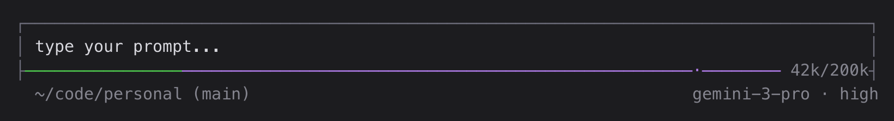

# pi-context-bar

Pi extension: turns the prompt box's bottom border into a live context progress bar, and cleans up the footer below it.



## What it looks like

```
┌────────────────────────────────────────────────────────────────┐
│ type your prompt...
├───────────·──────────────────────────────── 42k/200k ┤
  ~/Code/path (branch)                        gpt-5.1 · high
```

- **Bottom border** of the prompt box: a quiet solid `─` line from column 0
  - `─` filled (`success` green) = context used, `─` in the editor's live border color = headroom (the same live color pi paints the top separator with: thinking-level aware, e.g. violet at `high`, bash-mode green in bash mode)
  - `·` (inline middle dot) marks the auto-compaction threshold (window − compaction reserveTokens), in the line's own color
  - line ends in ` used/total` dimmed (unknown usage: `?/total`)
- **Bottom status**: lines hidden below the editor render Pi's native border instead of the bar — solid line, centered ` ↓ N more `, all in the border color
- **Footer**: cwd + git branch (+ extension statuses) left; `model · effort` right. Both parts dimmed via `theme.fg("dim")` per part, exactly like pi's original footer (token/cache/cost stats removed; context usage lives in the border bar)

## Installing

This extension ships in the [pi-0x1010](../../README.md) package:

```bash
pi install git:github.com/0x1010-dev/pi-0x1010
pi install ./pi-0x1010         # local path
```

Enable just this extension in settings (`pi config`), or one-off with
`pi -e ./pi-0x1010/extensions/pi-context-bar/index.ts`.

No runtime dependencies: pi's own packages (`@earendil-works/pi-coding-agent`, `@earendil-works/pi-tui`) are declared as `*` peerDependencies and supplied by the host.

## Layout

Part of the [pi-0x1010](../../README.md) monorepo — no per-extension
`package.json`, build step, or dev-link scripts. The root `package.json` is the
single pi package (manifest, `peerDependencies`, scripts); one root
`tsconfig.json` covers the tree.

```
index.ts                     # extension entry: session_start wiring + /cbar toggle
src/
  status-bar.ts              # pure bar renderer (unit tested)
  editor.ts                  # CustomEditor subclass overriding the bottom border
  footer.ts                  # custom footer component factory
test/status-bar.test.ts      # node:test suite, run by the root npm test
preview.png                  # committed gallery preview (root pi.image)
```

## Dev

From the repo root:

```bash
npm install
npm run typecheck   # tsc --noEmit over the whole tree
npm test            # tsx --test, all extensions' node:test suites
```

The `@earendil-works/*` packages are peerDependencies supplied by the host at
runtime — declare, never bundle. Tests must resolve paths from
`import.meta.dirname`, not the CWD.

## Disable

`/cbar` toggles the whole extension on/off per session.
